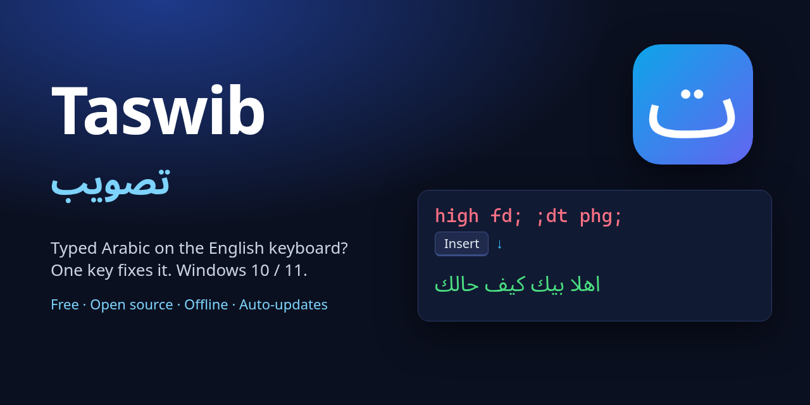
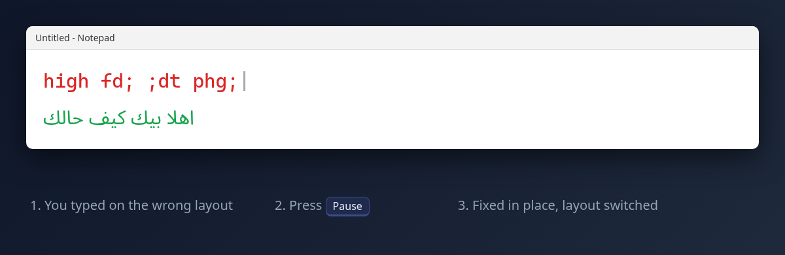
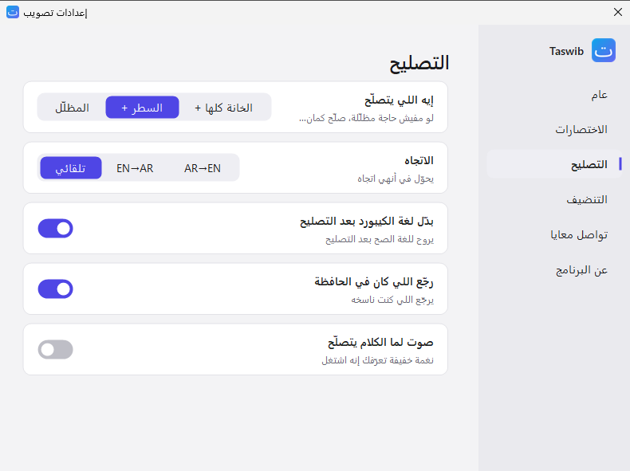

<div align="center">


# تصويب — Taswib

**كتبت عربي والكيبورد على إنجليزي؟ دوس زرار واحد والكلام يتصلّح. ويندوز 10 و 11.**

[](../../releases/latest)
[](../../releases)

[](LICENSE)

[English](README.md) · **العربية (مصري)**



</div>

<div dir="rtl">

بتكتب بسرعة ومخدتش بالك إن الكيبورد على إنجليزي، وطلعلك `high fd; ;dt phg;`؟
دوس **Insert**، وهيبقى `اهلا بيك كيف حالك`.

</div>



<div dir="rtl">

## المميزات

1. **زرار واحد**: ظلّل الكلام (أو متظلّلش حاجة) ودوس الاختصار.
2. **في الاتجاهين**: من إنجليزي لعربي ومن عربي لإنجليزي، وبيعرف الاتجاه لوحده.
3. **بيبدّل لغة الكيبورد** بعد التصليح، فتكمّل كتابة باللغة الصح على طول.
4. **بيشتغل في أي برنامج**: نوت باد، وورد، كروم، تيليجرام، واتساب، VS Code (أي حاجة بتدعم نسخ ولصق).
5. **الاختصار بتاعك**: سجّل أي كومبو، واختار إيه اللي يتصلّح (المظلّل، السطر، أو الخانة كلها).
6. **تنضيف الكلام العربي** (اختصار تاني `Shift+Pause`): `, ? ;` تبقى `، ؟ ؛`، و`أ إ آ` تبقى `ا`، و`ى` تبقى `ي`، وبيشيل التشكيل. مفيد لأسماء العملاء في الـ CRM والفورمات.
7. **واجهة بالعربي المصري**: بدّل الإعدادات وقائمة الـ tray للعربي المصري.
8. **تنصيب وتحديث تلقائي**: ملف `Setup.exe` واحد من غير صلاحيات أدمن، وبيتحدّث لوحده.
9. **خصوصيتك محفوظة**: شغّال من غير نت ومن غير تتبّع. التحديث بس بيكلّم GitHub.
10. **مجاني ومفتوح المصدر** (MIT).

## التنصيب

**بسطر واحد** (PowerShell ومن غير صلاحيات أدمن):

</div>

```powershell
irm https://raw.githubusercontent.com/deviengeorge/taswib/main/install.ps1 | iex
```

من **cmd**:

```
powershell -c "irm https://raw.githubusercontent.com/deviengeorge/taswib/main/install.ps1 | iex"
```

<div dir="rtl">

السكريبت بيختار النسخة المناسبة لوحده: مثبّت صغير (حوالي 16 ميجا) لو .NET 8 Desktop Runtime متثبّت عندك، وإلا النسخة الكاملة (حوالي 79 ميجا ومش محتاج تثبّت حاجة تانية).

أو بإيدك:

1. نزّل **`Taswib-win-Setup.exe`** من صفحة [الإصدارات](../../releases/latest) وشغّله.
2. هيظهر البرنامج في الـ tray (تحت على اليمين جنب الساعة).
3. دوس على الأيقونة ← **Settings** ← فعّل **Start with Windows**.

مش عايز تنصيب؟ نزّل النسخة المحمولة **`Taswib.exe`** من نفس الصفحة.

## الاستخدام

1. ظلّل الكلام الغلط، أو متظلّلش حاجة (هيصلّح السطر اللي قبل المؤشر).
2. دوس **Insert** (الاختصار الافتراضي).

## الإعدادات

</div>



<div dir="rtl">

دوس مرة على أيقونة الـ tray. التغييرات بتتحفظ فورًا، والشكل فاتح أو غامق حسب الويندوز. صور حقيقية لكل الصفحات في [`docs/screens`](docs/screens) (بتتصوّر أوتوماتيك من تشغيل على ويندوز في CI).

| الصفحة | فيها إيه |
| --- | --- |
| عام | شغّال · شغّله مع الويندوز · اللغة (English / عربي مصري) |
| الاختصارات | اختصار التصليح (الافتراضي `Insert`) · اختصار التنضيف (الافتراضي `Shift+Pause`) |
| التصليح | إيه اللي يتصلّح (المظلّل / + السطر / + الخانة) · الاتجاه · تبديل اللغة · استرجاع الحافظة |
| التنضيف | علامات الترقيم · توحيد الحروف |
| تواصل معايا | الصورة، الإيميل، واتساب، لينكدإن |
| عن البرنامج | الإصدار · دوّر على تحديث · GitHub |

بتتحفظ في `%APPDATA%\Taswib\settings.json`.

## أسئلة شائعة

**بيبعت كلامي لأي مكان؟** لأ. التحويل كله على جهازك. التحديث بس بيكلّم GitHub.

**بيدعم أنهي تخطيطات؟** QWERTY الأمريكي ⇄ العربي (101)، وهو تخطيط ويندوز العربي العادي.

**فيه مشكلة. أبلّغ إزاي؟** الإعدادات ← عن البرنامج ← **انسخ معلومات المشكلة**، وابعتها في [issue](../../issues) أو رسالة. فيها الإصدارات واللغات وسجل قصير، ومفيهاش الكلام اللي كتبته.

**مبيعملش حاجة في بعض البرامج.** ويندوز بيمنع الكتابة جوه البرامج اللي شغّالة كأدمن. شغّل تصويب كأدمن كمان، أو استخدم نافذة عادية.

**مفيش زرار Insert في اللابتوب بتاعي.** بعض اللابتوبات محتاجة `Fn` مع الزرار. أو افتح الإعدادات واختار اختصار تاني.

**زرار Insert مبقاش بيبدّل وضع الكتابة فوق الكلام.** تصويب بياخد الزرار على مستوى الويندوز كله. اختار اختصار تاني من الإعدادات لو محتاج الوضع ده.

## بناء من الكود

</div>

```
dotnet run --project tests/Taswib.Check
dotnet publish src/Taswib -c Release -r win-x64 --self-contained -p:PublishSingleFile=true
```

<div dir="rtl">

لما تعمل tag زي `v0.4.0` بيبني GitHub Actions المثبّت وينشر الإصدار لوحده.

## جاي بعد كده

تصليح تلقائي وإنت بتكتب · قائمة برامج مستثناة · التخطيط الفارسي · الفرانكو-عربي (`ezayak` ← `ازيك`).

## الرخصة

[MIT](LICENSE)

</div>
