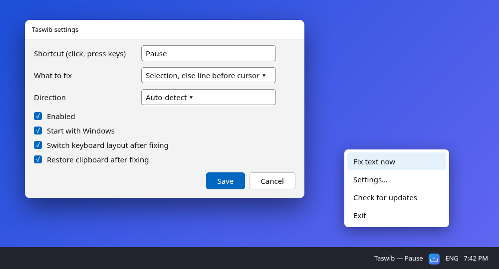

<div align="center">


# تصويب — Taswib

**كتبت عربي والكيبورد على إنجليزي؟ دوس زرار واحد والكلام يتصلّح. ويندوز 10 و 11.**

[](../../releases/latest)
[](../../releases)

[](LICENSE)

[English](README.md) · **العربية (مصري)**


</div>

<div dir="rtl">

بتكتب بسرعة ومخدتش بالك إن الكيبورد على إنجليزي، وطلعلك `high fd; ;dt phg;`؟
دوس **Pause**، وهيبقى `اهلا بيك كيف حالك`.

</div>


<div dir="rtl">

## المميزات

1. **زرار واحد**: ظلّل الكلام (أو متظلّلش حاجة) ودوس الاختصار.
2. **في الاتجاهين**: من إنجليزي لعربي ومن عربي لإنجليزي، وبيعرف الاتجاه لوحده.
3. **بيبدّل لغة الكيبورد** بعد التصليح، فتكمّل كتابة باللغة الصح على طول.
4. **بيشتغل في أي برنامج**: نوت باد، وورد، كروم، تيليجرام، واتساب، VS Code (أي حاجة بتدعم نسخ ولصق).
5. **الاختصار بتاعك**: سجّل أي كومبو، واختار إيه اللي يتصلّح (المظلّل، السطر، أو الخانة كلها).
6. **تنصيب وتحديث تلقائي**: ملف `Setup.exe` واحد من غير صلاحيات أدمن، وبيتحدّث لوحده.
7. **خصوصيتك محفوظة**: شغّال من غير نت ومن غير تتبّع. التحديث بس بيكلّم GitHub.
8. **مجاني ومفتوح المصدر** (MIT).

## التنصيب

1. نزّل **`Taswib-win-Setup.exe`** من صفحة [الإصدارات](../../releases/latest) وشغّله.
2. هيظهر البرنامج في الـ tray (تحت على اليمين جنب الساعة).
3. دوس مرتين على الأيقونة ← **Settings** ← فعّل **Start with Windows**.

مش عايز تنصيب؟ نزّل النسخة المحمولة **`Taswib.exe`** من نفس الصفحة.

## الاستخدام

1. ظلّل الكلام الغلط، أو متظلّلش حاجة (هيصلّح السطر اللي قبل المؤشر).
2. دوس **Pause** (الاختصار الافتراضي).

## الإعدادات

</div>



<div dir="rtl">

| الإعداد | بيعمل إيه |
| --- | --- |
| الاختصار | دوس على الخانة واضغط أي كومبو، زي `Ctrl+Shift+Space` |
| إيه اللي يتصلّح | المظلّل بس · المظلّل أو السطر · المظلّل أو الخانة كلها |
| الاتجاه | تلقائي، أو إجباري من إنجليزي لعربي أو العكس |
| تبديل لغة الكيبورد | يروح للعربي أو الإنجليزي بعد التصليح |
| استرجاع الحافظة | يرجّعلك اللي كنت ناسخه قبل كده |

بتتحفظ في `%APPDATA%\Taswib\settings.json`.

## أسئلة شائعة

**بيبعت كلامي لأي مكان؟** لأ. التحويل كله على جهازك. التحديث بس بيكلّم GitHub.

**بيدعم أنهي تخطيطات؟** QWERTY الأمريكي ⇄ العربي (101)، وهو تخطيط ويندوز العربي العادي.

**مبيعملش حاجة في بعض البرامج.** ويندوز بيمنع الكتابة جوه البرامج اللي شغّالة كأدمن. شغّل تصويب كأدمن كمان، أو استخدم نافذة عادية.

**مفيش زرار Pause في اللابتوب بتاعي.** افتح الإعدادات واختار اختصار تاني.

## بناء من الكود

</div>

```
dotnet run --project tests/Taswib.Check
dotnet publish src/Taswib -c Release -r win-x64 --self-contained -p:PublishSingleFile=true
```

<div dir="rtl">

لما تعمل tag زي `v0.4.0` بيبني GitHub Actions المثبّت وينشر الإصدار لوحده.

## جاي بعد كده

تصليح تلقائي وإنت بتكتب · قائمة برامج مستثناة · التخطيط الفارسي · واجهة عربي للبرنامج.

## الرخصة

[MIT](LICENSE)

</div>
