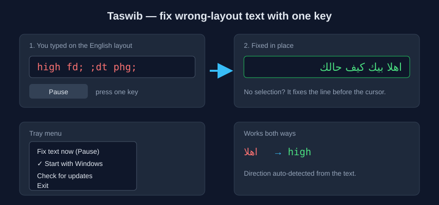

# Taswib — تصويب

Typed Arabic with the English layout on? Press **Pause** and the text fixes itself.



`high fd; ;dt phg;` → `اهلا بيك كيف حالك`

## Install

1. Download `Taswib.exe` from [Releases](../../releases/latest).
2. Run it. It sits in the tray. No installer, no admin.
3. Tray menu → **Start with Windows** if you want it always on.

Windows 10/11 x64. Fully offline, nothing is sent anywhere.

## Use

1. Select the wrong text, or select nothing (it fixes the line before the cursor).
2. Press **Pause**.

Direction (EN→AR or AR→EN) is detected from the text. Mapping is US QWERTY ⇄ Arabic 101.

## Update

Tray menu → **Check for updates** opens the latest release page.

## Build

```
dotnet run --project tests/Taswib.Check        # mapping check
dotnet publish src/Taswib -c Release -r win-x64 --self-contained -p:PublishSingleFile=true -p:EnableCompressionInSingleFile=true -p:IncludeNativeLibrariesForSelfExtract=true
```

Releases are built by GitHub Actions: push a tag `v0.1.0` and `Taswib.exe` is attached.

## Not yet

Auto-fix while typing, auto-switch layout after fixing, configurable hotkey.
