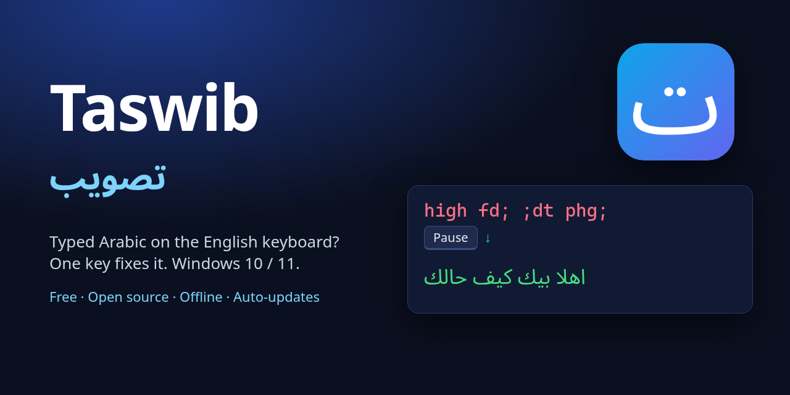
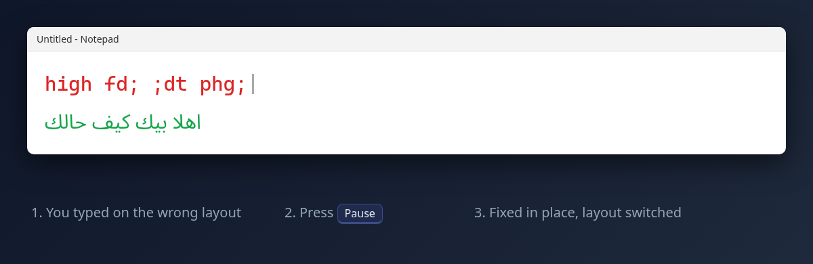

<div align="center">


# Taswib — تصويب

**Fix text typed in the wrong keyboard layout. Arabic ⇄ English, one key, Windows 10 / 11.**

[](../../releases/latest)
[](../../releases)

[](LICENSE)

**English** · [العربية (مصري)](README.ar.md)



</div>

Typing fast, didn't notice the keyboard was on English, and got `high fd; ;dt phg;`?
Press **Pause**. You get `اهلا بيك كيف حالك`.



## Features

1. **One key fix**: select the text (or nothing) and press the shortcut.
2. **Both directions**: English→Arabic and Arabic→English, auto-detected.
3. **Switches your keyboard layout** after fixing, so you keep typing in the right language.
4. **Any app**: Notepad, Word, Chrome, Telegram, WhatsApp, VS Code (anything that supports copy/paste).
5. **Your shortcut**: record any key combo, choose what gets fixed (selection, line, whole box).
6. **Installer + auto-update**: one `Setup.exe`, no admin rights, updates itself.
7. **Private**: fully offline, no telemetry. Update check only contacts GitHub.
8. **Free and open source** (MIT).

## Install

1. Download **`Taswib-win-Setup.exe`** from [Releases](../../releases/latest) and run it.
2. Taswib appears in the tray (bottom-right, near the clock).
3. Double-click the tray icon → **Settings** → tick **Start with Windows**.

Prefer no install? Grab the portable **`Taswib.exe`** from the same page.

## Use

1. Select the wrong text, or select nothing (it fixes the line before the cursor).
2. Press **Pause** (default).

## Settings


| Setting | What it does |
| --- | --- |
| Shortcut | Click the box, press any combo, e.g. `Ctrl+Shift+Space` |
| What to fix | Selection only · selection else line before cursor · selection else whole text box |
| Direction | Auto-detect, or force English→Arabic / Arabic→English |
| Switch keyboard layout | Jump to Arabic/English after fixing |
| Restore clipboard | Put back what you had copied |

Saved in `%APPDATA%\Taswib\settings.json`.

## FAQ

**Does it send my text anywhere?** No. Conversion is local. Only the update check contacts GitHub.

**Which layouts?** US QWERTY ⇄ Arabic (101), the standard Windows Arabic layout.

**It does nothing in some window.** Windows blocks input into apps running as administrator. Run Taswib as administrator too, or use a normal window.

**Pause key missing on my laptop.** Open Settings and choose another shortcut.

## Build from source

```
dotnet run --project tests/Taswib.Check
dotnet publish src/Taswib -c Release -r win-x64 --self-contained -p:PublishSingleFile=true
```

Pushing a tag like `v0.4.0` makes GitHub Actions build the installer and publish the release.

## Roadmap

Auto-fix while typing · per-app blocklist · Persian layout · Arabic app UI.

## License

[MIT](LICENSE)

<sub>Keywords: wrong keyboard layout fixer, Arabic English keyboard converter, Arabic typing in English layout, Punto Switcher alternative for Arabic, Mahou alternative, layout switcher Windows 11.</sub>
